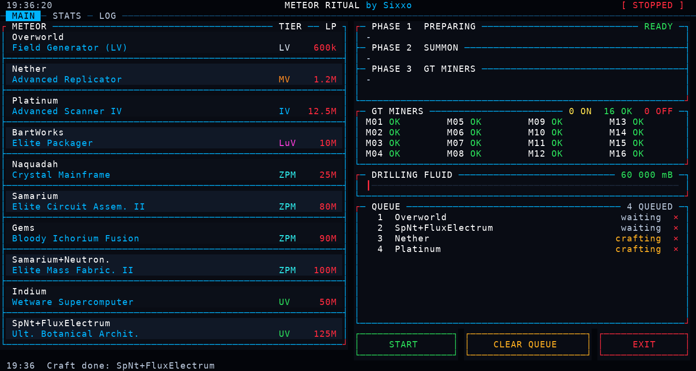
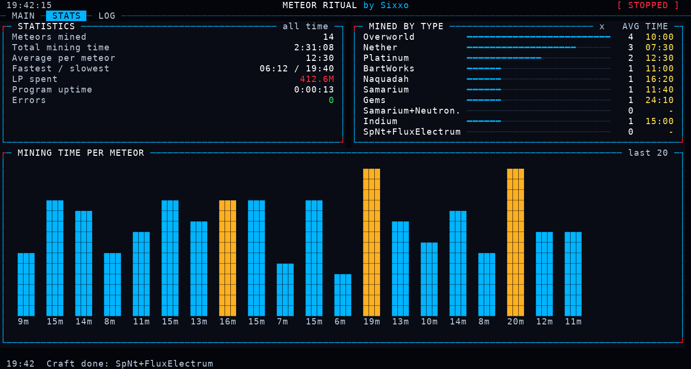
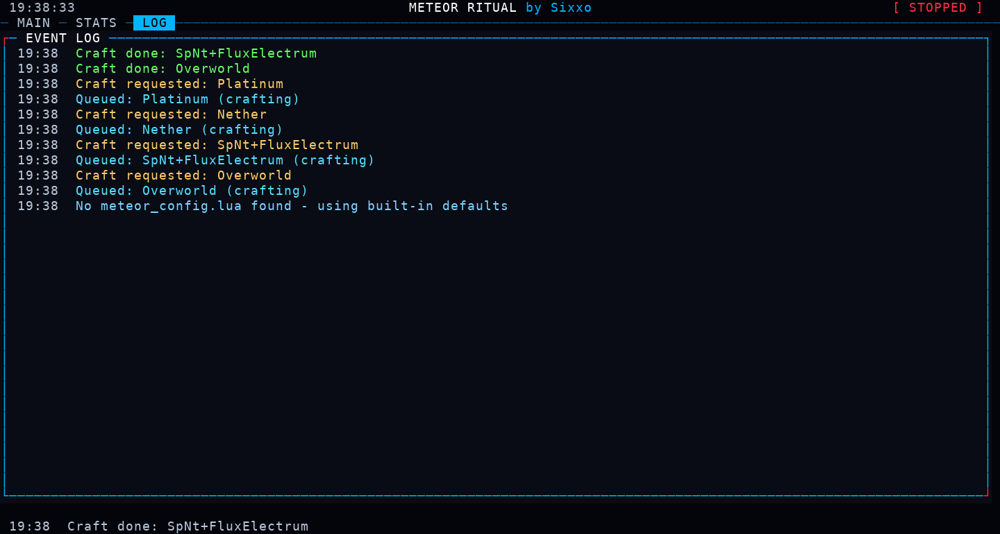

# Meteor Ritual Controller

An OpenComputers (OpenOS) touchscreen controller for the **Blood Magic Meteor ritual** in
GregTech: New Horizons. It queues meteors, summons them, starts 16 GT Ore Drilling Plants,
waits until the whole meteor is mined and then moves on to the next one. Everything is
controlled from a neon-style touch UI.

> Screenshots are renders of the real screen output made with a Lua simulator (sample data).



## Features

- **Meteor queue.** Touch a meteor to queue it. The catalyst is moved by a transposer from an
  ME Interface into a dropper (max. one in the dropper) and fired with a redstone pulse.
  Each queued entry has a red cross to remove it again.
- **Automatic ritual start.** One redstone pulse (Dynamism Tablet) one second after the
  catalyst drop, then one pulse that starts the miners a few seconds later.
- **Live miner status.** 16 GT Ore Drilling Plants shown as `ON` / `OK` / `OFF` / `N/A`.
  The next meteor only starts when every miner is idle.
- **Drilling Fluid from ME.** Current amount plus a bar on a 0 - 100 000 000 mB scale. A new
  meteor is not summoned without enough fluid.
- **Automatic crafting.** A catalyst that is missing in the ME system is requested for
  crafting and the meteor waits in the queue until it is ready.
- **Three phases per meteor.** PREPARING, SUMMON and GT MINERS (with a "deploying pipe"
  period after the miners start).
- **Statistics, event log, real-time clock.**
- **Full-screen layout.** The program reads the screen's aspect ratio and picks a resolution
  of 35 rows and 80 - 160 columns, so the UI fills the whole screen.

## Tabs

| Tab | What it shows |
| --- | --- |
| **MAIN** | Meteor list (name, catalyst, tier, LP cost), state, miners, Drilling Fluid, queue and the START / STOP, CLEAR QUEUE, EXIT buttons |
| **STATS** | Meteors mined, total / average / fastest / slowest mining time, LP spent, uptime, errors, count and **average mining time per meteor type**, chart of the last meteors |
| **LOG** | Full event log with timestamps |





Statistics are saved to `/home/meteor_stats.lua` after every finished meteor, so they survive a
restart of the computer.

## Flow

```
idle -> wait_start -> mining -> finish -> idle
```

1. The catalyst is moved to the dropper and the dropper is fired (t = 0).
2. Ritual start pulse (first meteor of a program run).
3. Miners start pulse a few seconds later.
4. Mining. When all miners stay OFF for a short confirmation time the meteor counts as mined.
5. The next queued meteor is started.

## Hardware

- Computer with a Tier 3 GPU and screen (a larger multi-block screen is recommended)
- Transposer between an ME Interface (catalysts) and a dropper
- Redstone I/O blocks for: the dropper, the ritual start and the miners start
- A GT machine adapter next to each GT Ore Drilling Plant controller (up to 16)
- An ME controller or ME interface adapter (items, crafting and fluids)

## Installation

Download the program to the computer:

```
wget -f https://raw.githubusercontent.com/Sixxoo/GTNH-Meteor-automation-/main/meteor.lua /home/meteor.lua
```

Edit the settings at the top of `meteor.lua` (see below), then run:

```
/home/meteor.lua
```

## Settings

Everything is configured by editing the top of `meteor.lua`:

| Setting | Meaning |
| --- | --- |
| `OUT` | Redstone I/O address prefix and side for `dropper`, `ritual` and `miners` |
| `SOURCE_SIDES`, `DROPPER_SIDE` | Transposer sides of the ME Interface and the dropper |
| `ME_ADDR` | Address prefix of the ME controller / interface |
| `MINER_ADDRS` | Address prefixes of the GT machine adapters (M01 - M16) |
| `METEORS` | List of meteors: label, catalyst, optional short text, tier, LP cost (max. 12) |
| `START_DELAY`, `RITUAL_DELAY`, `IDLE_CONFIRM` | Timing in seconds |
| `FLUID_START_MIN`, `FLUID_BAR_MAX` | Drilling Fluid limits |
| `RESOLUTION` | `nil` fits the screen automatically, or set e.g. `{120, 35}` |

List the component addresses of your computer with the `components` command. The first few
characters of an address are enough.

## Helper

`minerinfo.lua` prints everything a GT machine adapter reports about one miner. Run it once on
a healthy miner and once on a faulty one to compare the data:

```
minerinfo 68e3
```
